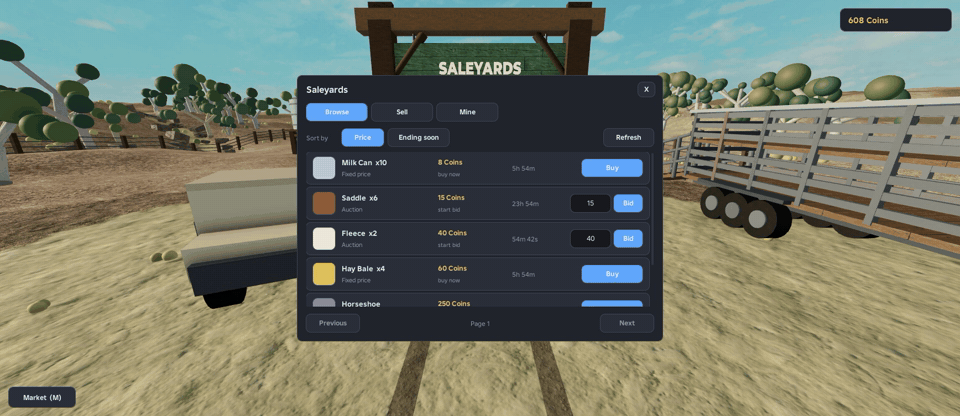
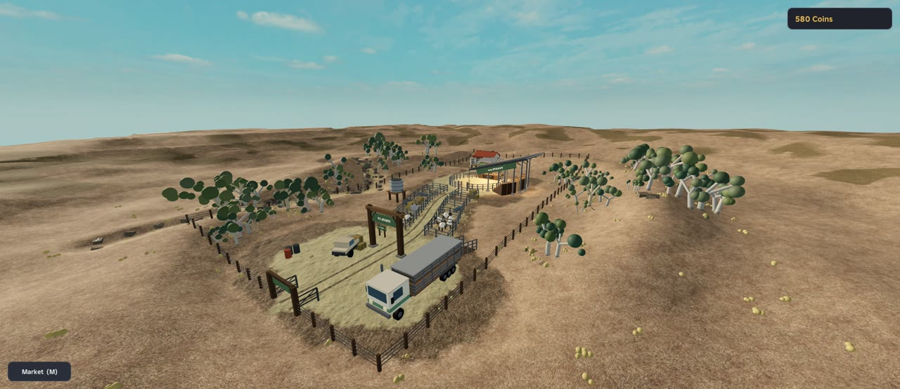
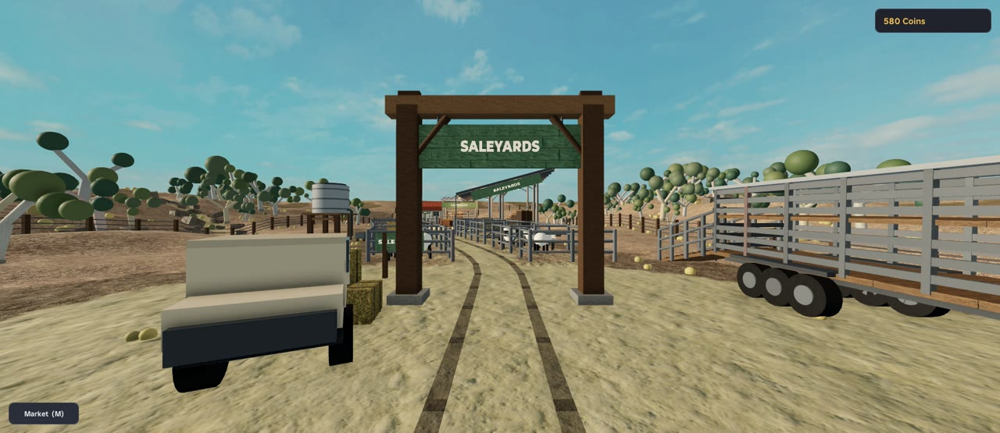
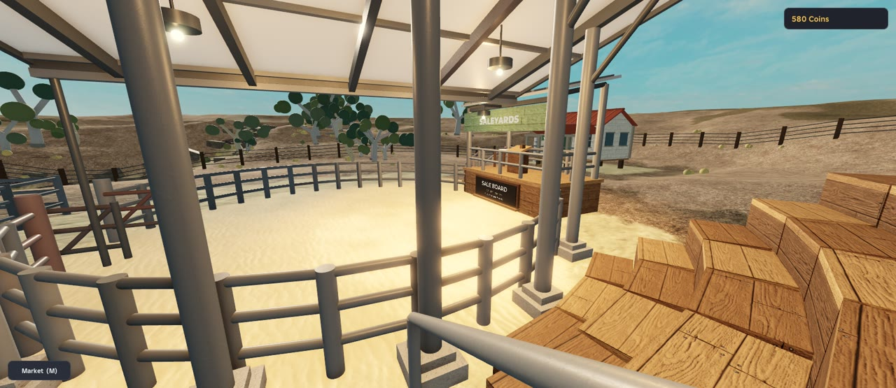
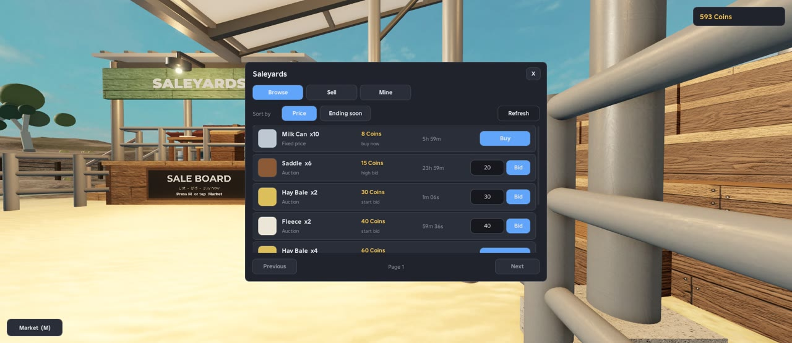

<div align="center">

# saleyards

A cross-server marketplace for Roblox: fixed-price listings and timed auctions, with escrow designed to survive a server dying at any write (proven against Lune fakes). It leaves out item art, unique items with their own data and anything a player does with what they buy. Player data is saved with a session lease, the same store as [satchel](https://github.com/Provokke/satchel).

    

Refer to [LICENSE](LICENSE) for the legal bits.

</div>



## What's in it

- **Fixed-price listings and timed auctions.** A seller lists a stack of one item (`hay_bale`, `fleece`, `horseshoe`, `saddle`, `milk_can` or `wool_bale` in the shipped config) at a price or a start bid, for 1, 6 or 24 hours. A buy takes the whole stack. A bid has to beat the high bid by `MinIncrement`, a bidder can't outbid themselves and a seller can't buy or bid on their own listing. A listing past its end time is final, whatever it last said.
- **Any server can buy.** Each listing is one DataStore key, so a buyer on one server can buy from a seller who is on another server, or is not in a game at all. The seller is paid the next time they are in one.
- **Claims, not a mailbox.** What a player has staked in a listing is a claim in their own profile. A listing claim holds the items and the fee, a buy claim holds the price, a bid claim holds the bid. Settlement reads the listing and resolves the claim, and a claim is removed only in the same profile save that applies its result. A profile holds up to `MaxOpenClaims` (10) at once.
- **Server-priced money.** A listing costs a flat `ListingFee` (5 Coins), kept by the yards once the listing exists and returned only if it never went on sale. A sale pays the seller the price less `floor(price × SaleTax)`, 10% by default. Whole Coins only, and the client never sends a price it can't be held to: a buy sends the price it saw and is refused if the listing has changed.
- **Settlement that can be repeated.** On join, once straight after each call and every `SettleSeconds` (30) for players holding claims, each claim is decided from the listing key by a pure function (`Settle.decide`). Every step is safe to run again, so a crash at any point just means the next settle decides from the same facts.
- **Browsing is a cache.** Open listings sit in two MemoryStore sorted maps (in-memory ones in Studio), one by price and one by end time, and the Browse call returns one page of `BrowsePageSize` (20). Losing the maps loses no Coin or item.
- **Server authority.** Clients send intent only (`list`, `buy`, `bid`, `cancel` or a Browse page). Every call is checked for type and range, rate limited per player and then checked against the rules. A bad call is dropped and counted. A call the rules refuse changes nothing and the player gets the reason in the next Sync, which also carries Coins, items, claims and new notices. A call dropped because the player's last one is still running is answered `busy`.
- **Market board.** Three tabs (Browse, Sell and Mine) over the Coins HUD, with a toast for each settled sale, refund or win.

| Key | Does |
|---|---|
| M, or the Market (M) button | Opens and closes the market board |

```lua
-- src/shared/Config.luau
Items = table.freeze({
	hay_bale = table.freeze({ name = "Hay Bale", colour = table.freeze({ 220, 190, 90 }) }),
}),
```

## The one rule

**A claim goes into the player's profile and is saved before any shared write. The listing key is never deleted, only tombstoned. A refund voids first.**

Every operation follows it, and the next section walks through what that buys.

## How a sale moves

Every list, buy, bid and cancel moves Coins and items through `Market.luau`, and every one starts in the player's own profile.

- **List: stake, save, create.** The items and the fee come out of the profile in memory and a listing claim goes in. The profile is saved, and only then is the listing created, by an `UpdateAsync` that refuses to overwrite anything. If the save fails, the change is put back and nothing shared is written. If the create fails or its answer is lost, the claim stays and settlement resolves it: a listing that never landed is voided (a tombstone is written on its key) and then the items and the fee come back.
- **Buy: stake, save, buy, settle.** The price comes out and a buy claim with a fresh `buyId` goes in, then the profile is saved. A pre-read of the listing refuses a buy that can't win before anything is staked. The buy is written next, and the buyer's claim is settled straight away: if the listing shows this `buyId`, the item is given. If not, the `buyId` is voided first, the listing is read again and the Coins are refunded only if the buy still isn't there. Voiding first is what stops a buy that looked lost, but did land, from paying out twice.
- **Bid: the same shape.** The bidder's Coins stay held in the bid claim until settlement shows they were outbid (void, read, refund) or the auction ended with their bid on top (the item is given).
- **Cancel: needs a claim.** Only the seller can cancel, only while the listing is open and has no bid, and a cancel is refused before any store call unless the player holds a listing claim on that id.
- **Time-final listings are closed by a write.** A listing past its end is written to state `ended` (`Listing.close`) before anyone acts on it, so "ended" is a stored fact and a server whose clock is a second out can't pay a seller and a buyer for the same thing. `Settle.needsClose` says when a claim needs that write, and checks the claim is the player's own listing or own high bid.
- **Ownership is checked at settlement.** `Settle.decide` returns a listing claim whose id now belongs to someone else's listing, with its fee and no write. A buy or bid whose id matches another player's is not treated as theirs.
- **A call settles only its own claim.** After a call, only the claim that call touched is settled. The rest wait for the 30 second poll, so an outbid refund can take up to `SettleSeconds` to show. This bounds what one call costs the store.
- **A save is bound to the live session.** The save a Market call makes is bound to the profile it staked into. If the player left and rejoined while the call waited, the call is refused (`no_profile`) or its save returns false, so a dead session can't stake Coins into a live one.
- **Seller payouts.** A sale pays `price - floor(price × SaleTax)` to the seller's claim when it next settles. An auction pays on its high bid. A listing that ends unsold returns the items and keeps the fee. A cancel returns the items and keeps the fee too.

### What a crash does

- **Before the profile save:** nothing shared has been written, and the stored profile is as it was.
- **After it, before the shared write:** the claim is in the stored profile, so the next settle finds the listing missing, voids it and returns what was staked.
- **After the shared write, before the settle:** the claim is still there, so the next settle decides from the listing and applies the result once.
- **After the settle's save:** the claim is gone, so nothing is applied twice.

## 🎮 Demo place

`demo/saleyards.rbxl` is a ready-made place: a stock yard with a gate, a sale ring and a sale board. Open it in Studio and press Play. In Studio the server uses an in-memory store, and the `SaleyardsDemoSeed` attribute on ServerStorage seeds the market with six pretend sellers (a mix of fixed and auction listings, one auction ending in 90 seconds) and one sale of yours that has already gone through, so the first settle shows a payout notice. You start with 500 Coins, 6 Hay Bales, 4 Fleeces and 8 Horseshoes. The market opens with the Market (M) button or the M key. The sale board in the yard is a sign pointing to it.

To use the real DataStore, set the attribute `SaleyardsUseDataStore` to true on ServerStorage and turn on API access for the place.

| The yard | The gate |
|---|---|
|  |  |
| **The sale ring** | **The sale board** |
|  |  |

- The scene is a low-detail stylised backdrop with primitive trees and vehicles, checked in Studio lighting.
- Studio runs one server, so the demo can't show a cross-server sale. The seeded payout is minted for the demo and is not part of the conservation claim. Coming back after a rejoin isn't shown either: an in-memory store forgets everything when the play test stops. The specs cover both.

## 🏗️ Architecture

```
                     Player joins / leaves / autosave / shutdown
                                   |
                                   v
 init.server.luau  ------->  Sessions  ---->  Store  ---->  Lease (claim / refresh / release)
 (services, remotes,                            |    ---->  Migrations + Steps
  poll, demo seed)                              |    ---->  Profile (coins, items, claims, notices)
        |                                       v
        |                                  DataStore  (in-memory in Studio)
        |
        |  Request (RemoteEvent)    Browse (RemoteFunction)    Sync (RemoteEvent)
        |  <-----------------------------------------------   ------------------>
        v                                                                      client
   Handlers  -- Validate, RateLimiter ---> Market ---> Listing (transforms), Settle (decisions)
                                              |
                                              +--->  Index (MemoryStore sorted maps, a cache)
```

The write order for any operation:

```
1. claim          the stake goes into the player's profile, and the profile is saved
2. listing        one UpdateAsync on the listing key, running a pure Listing transform
3. settle         read the listing key, decide with Settle, apply it to the profile, save
                  (the index is updated after a save, best effort, and is never read to decide)
```

```
src/
  server/
    init.server.luau   services, remotes, the settle poll, autosave and shutdown loops, demo gate
    Sessions.luau      session lifecycle on one server: load, release, autosave, saveNow, shutdown wait
    Listing.luau       the only code that writes a listing: pure create, buy, bid, cancel, close, void and markSettled
    Settle.luau        pure decisions: what a claim does given what the listing shows
    Market.luau        list, buy, bid, cancel and settle: stake, save, write, settle, behind a lock per player
    Index.luau         the browse cache: two sorted maps, every call wrapped so a failure is only logged
    Handlers.luau      validates and rate limits every client request, one at a time per player, then syncs
    DemoSeed.luau      Studio-only seeded listings
    Data/
      Lease.luau       claim, refresh and release transforms
      Migrations.luau  upgrades saved data one schema step at a time
      Steps.luau       the migration steps
      Profile.luau     what a new profile holds, and how it is encoded for storage
      Store.luau       loads, saves and releases sessions over a DataStore
      MemoryStore.luau in-memory stand-in with the same UpdateAsync contract, used in Studio
      MemorySortedMap.luau in-memory stand-in for the browse cache, used in Studio
  shared/
    Config.luau        items, fee, tax, limits, timings: the one place to edit
    ConfigCheck.luau   refuses to start the server on a bad config
    BoardLogic.luau    the board's pure rules: time left, next bid, what a seller receives, plain-word replies
    RateLimiter.luau   token bucket per player
    Validate.luau      type and range checks for remote arguments
  client/
    init.client.luau   wires input, the Coins count-up, Browse and Sync
    Board.luau         the Browse, Sell and Mine tabs
    Theme.luau         colours and small UI helpers
```

## 🚀 Quick start

```
rokit install
rojo serve
```

Or open `demo/saleyards.rbxl` and press Play.

The tools are pinned in `rokit.toml`: Rojo 7.4.4, Lune 0.8.9, StyLua 2.0.2 and Selene 0.27.1. To start from an empty baseplate, connect the Rojo plugin and press Play. You start with 500 Coins and a few items, and M opens the market. Players in one Studio test server trade with each other, but nothing crosses servers there.

To change what can be sold, or the fee, tax and limits, edit `Config.luau`. The server refuses to start on a bad config.

In Studio the server uses an in-memory store and in-memory sorted maps, so the place runs unpublished and nothing is saved between plays. To use the real DataStore, set the attribute `SaleyardsUseDataStore` to true on ServerStorage and turn on API access for the place. To fill the market with listings in Studio, set `SaleyardsDemoSeed` to true on ServerStorage.

The checks CI runs:

```
stylua --check src tests
selene src
cd tests && selene .
lune run tests/run
lune run tests/mutate
lune run tests/mutate -- --self-check
rojo build -o build/saleyards.rbxl
```

## 🧪 Testing

```
lune run tests/run
```

310 tests, all passing:

- Listing (14) and Listing fuzz (1): every transition and every refusal, `close` ending a listing at its end time and writing nothing else, void never changing a sale or a bid, and seeded random action sequences keeping the invariant that a listing ends with at most one buyer or one winning bid and never leaves a final state.
- Settle (18): every row of the decision table, including the void-then-read-again branches, a bid that wins after the end even if its id was voided, another seller's listing under our id, a buyId or bidId that matches another user, and `needsClose`.
- Market (31): each operation's money (stake saved before the listing write, refusals that move nothing, a failed save that rolls back, a lost create, a bid war where the loser is refunded once), the per-player lock, plain-word notices, cancel refused before any store call without a claim, a call settling only its own claim, a foreign listing claim returned and not written, and the browse cache kept in step.
- Market close (8): a cached open read can't refund items a buyer bought, a late high bid is paid, and a server a couple of seconds behind is refused once the end is written, each with a negative control that breaks it. Two more cover ownership of a listing's id, again with a control.
- Races (16): two settles for one user on one server (the second is turned away and the refund is paid once), a server whose clock is ahead, two servers over one store with interleaved yields, and a negative control for each.
- Crash at every write (31): crash injection at every write of every operation, in both modes (the server stops with the write unapplied, or the write lands and its answer is lost), including settlement and refunds, then every pair of lost writes, with the read cache on and off. After each, the servers restart over the stored records, settle until quiet and check conservation. The controls break the write-ahead save, the void-before-refund and the buyer check, and each must fail the walk.
- Session conservation (13): the same check through the real `init.server.luau`, Sessions, Store and Lease over the stand-in services. A leave and rejoin during a buy's or a bid's first read, a leave and rejoin during the settle's read, a settle that outlives its session, a lease taken by another server after it expired (with a buy in flight, and with the listing write in flight), a leave during a call, a leave while a write outlasts the wait, an autosave queued behind a failing listing or buy save (the stake is rolled back before it can run), and a shutdown with a hung listing write or a hung save, and one that keeps part of its timeout for the release.
- Conservation (7): the checker itself. It counts Coins, items and leftover claims from the stored records, and fails on one extra Coin, one missing item, a claim left over or tax taken from the wrong amount.
- Faults (11): the crash injector. A stop at write k lets earlier writes land, a lost write applies and raises, a read is not a write, the sorted map shares the write counter, and a pair of lost writes carries on.
- Handlers (15): bad arguments dropped with no market call, range edges, a refusal passed on with its reason, a market call that throws (logged once), a second call dropped and answered `busy`, the rate limit and its refill, a list-then-cancel loop and made-up buys held to the store allowance and answered `slow_down`, Browse not charged, and Browse paging and bad arguments.
- Server script (12): the real `init.server.luau`, run over a small stand-in for the Roblox services it uses (`tests/fakes/FakeGame.luau`). A bad config refuses to start, a joining player is synced, a join settles held claims, a list and a buy go through the remotes and the seller is paid by the poll, bad requests are dropped, a leave and BindToClose wait for a running call (and no longer than the timeout), and a rejoin on a restarted server keeps the claim. Two more run a list-then-cancel loop and made-up buys through the remotes and count the UpdateAsync and GetAsync calls that reach the store.
- Index (3): paging by price and by ending, entries that expire at their end and can be removed, and a failure that is logged and never raised.
- Demo seed (6): six sellers and one auction ending in 90 seconds, every listing one `Listing.create` would make, no duplicates or second payout when seeded twice, the entry script seeding only in Studio with the attribute and in-memory stores, and an unpublished place, where MemoryStoreService refuses, starting, seeding and browsing.
- Board logic (10): grouped Coins, time left, the price a browse row shows, the next bid, the tax floor, when cancel is allowed, each draft check, and plain words for every reason the server gives (including `slow_down`).
- Config checks (13): the shipped config passes, and each rule fails when broken and passes when fixed, including the store limits and a cost for every store action.
- Lease (13): new, taken, stolen and held outcomes, expiry, refresh, release, lost leases, records with no lease, a release that already landed, and no mutation of the stored record.
- Migrations (5): steps run in order, current records are unchanged, records from the future go read-only, the input is never mutated, and a missing step names the schema.
- Fake data store (5), Fake sorted map (5), Memory store (3) and Memory sorted map (3): the fakes re-run transforms on fresh copies, can fail after writing and cancel on nil, the sorted maps order and page like Roblox's and expire entries, and the in-memory stores copy in and out.
- Store (11), Store leases (8), Store loads (8) and Store saves (5): fresh loads, two-server lockout, stealing an expired lease, load retries, persistent failure, read-only saves and releases, leases that landed but errored, long release outages, loads called off when the player leaves, and an older autosave that can't land after a newer save.
- Sessions (9) and Sessions saveNow (6): a quick rejoin waiting for the old release, a rejoin during a slow load, shutdown within its timeout, read-only and lost sessions, and `saveNow` true only when the write landed and false for no session, a failed write, a lost lease or a read-only session.
- Profile (6): starting Coins and items, a separate copy of the starting items for each profile, every field kept through encode and decode, bad data refused, and the first migration.
- Rate limiter (4) and Validate (10): a full bucket allows exactly its capacity, time refills it, and integers, strings and set membership, including NaN, infinity, floats, wrong types and out-of-range values.

Every race and crash spec has a negative control: a deliberately broken version that must fail it.

**Mutation runner.** `lune run tests/mutate` applies each of the 22 patches in `tests/mutants` to a throwaway copy of `src` and `tests`, runs the full suite there and requires a failure. The mutants break one behaviour each: no write-ahead save, a refund without voiding first, a claim that isn't removed, a pay without the buyer check, a buy that ignores state, a bid that ignores the end, no busy lock, a time-final listing decided without a close write, a cancel without a claim, a call that settles every claim, a save not bound to the profile, a stake into a dead session, a stale browse entry kept, a foreign listing marked, a market call not charged to the store limiter, a failed stake rolled back outside the session lock (listing, buy or bid), and a Studio browse cache that needs a published place. A mutant that survives, or whose find text no longer matches (stale), or that breaks the build, fails the run. `lune run tests/mutate -- --self-check` proves the runner itself: a harmless mutant must be reported as surviving, a stale one as stale and a build-breaking one as broken. Currently 22 killed, none surviving.

The client script and the UI can't run under Lune. They build with Rojo and are checked in Studio. The stand-in the server script runs on models only the members it uses, but it is not Roblox. The runner counts a test that yields and never finishes as a failure, so a hung test can't end the run with no output.

Every operation saves the player's stake in their own profile before it writes the shared listing, and settles from the listing afterwards. In the Lune specs, a server crash or a lost response at any single write, or two lost responses at any pair of writes, leaves every Coin and item accounted for, in a profile, an open listing, a claim in flight, or the tax and fee sink. The same holds through the real session layer for a leave and rejoin during a buy's or a bid's first read and during the settle's read, a lease taken by another server after it expired, a leave while a call is in flight, and a shutdown with a hung write.

## ⚠️ Honest limits

- Saving has only been tested against a fake data store in Lune. None of it has run against a real Roblox DataStore yet, so throttling, outages and real request budgets are unproven.
- **Proven against fakes, not Roblox.** Cross-server races and crash recovery are proven against Lune fakes of DataStore and MemoryStore, not on Roblox servers. Studio runs one server, so the demo can't show cross-server behaviour. Real request budgets, throttling, MemoryStore quotas and per-key limits are not modelled or measured, and a read that fails on a live server is not walked at every site.
- **Two proof layers.** The write-by-write crash walk runs the market over a simple test profile store. The real session layer (lease, leave and rejoin, release, shutdown) is checked by its own specs, each counted from the stored records after a restart, for the cases listed above. It is not a crash at every write of the real session layer, and there is no mutant of the lease check itself.
- **Some cases rest on how UpdateAsync is documented.** These are a write that lands after its server has died, and a second crash during recovery. They are argued, not proven: the fakes don't model them. The design relies on UpdateAsync re-running a transform when the key changed underneath it, as Roblox documents, and on every settlement step being safe to repeat.
- **Coins, items and claims share one record.** They must stay in the same profile record as the claims. A separate ledger breaks the write-ahead save.
- **Players settle only while in a game.** Nothing is pushed to an offline player. Their sales, refunds and wins settle on their next join, and other claims on the 30 s poll.
- **Outbid refunds wait for the poll.** A call settles only its own claim, so a refund for an outbid bid can take up to `SettleSeconds` to arrive.
- **Listing keys are kept for ever.** They stay as small tombstones, and there is no cleanup sweep.
- **Server clocks can differ at an auction's end.** The end is written before anyone is paid, so this can't make or lose Coins, but a bid in the last second can be refused by one server and accepted by another. There is no anti-snipe extension.
- **Stackable items only.** An item is an id and a count.
- **Browsing is a cache.** A listing can show after it has sold or been cancelled; the buy is then refused, and the entry is dropped when it is found out.
- **Sellers are visible in browse.** Each Browse entry carries the seller's UserId, which the client uses to mark its own listings. UserIds are public on Roblox, but every client can see who is selling what.
- **Request budget not checked live.** The server reads its budget under `Enum.DataStoreRequestType.UpdateAsync`; whether that still reports the live budget has not been checked on Roblox, and it can't be checked offline.
- **A call costs the store a bounded amount.** Measured on the fakes, a list makes about 2 UpdateAsync, and a buy or a cancel about 3 UpdateAsync plus up to 2 GetAsync. Each player also has a store allowance: list, buy, bid and cancel each spend 3 of a 12-operation burst that refills at 9 a minute, so about three market calls a minute once the burst is gone, and a call over it is answered `slow_down`. Browse is not charged. An unchanged high bid still rewrites its browse entry.
- **The store limit is an estimate.** The per-player store limit is a fixed figure chosen to sit well inside Roblox's documented per-server request budget, which grows with the player count. It has not been measured on a live server. It only charges market calls: settles run later by the 30 s poll (refunds and payouts) are not charged, and a call refused before it reaches the store still costs its full allowance.
- **A save refused before the session lock has no fallback undo.** A failed stake save is rolled back inside the session lock, but a save refused before it gets there (no session, a different profile, or an early return in `saveNow`) leaves the stake in memory, because there is no repeat-safe fallback undo. There is no live exposure today: every refusal that can reach that point involves a profile that is never written again (a dead, lost, read-only or released session), and the claim saved first is voided and refunded on the next settle.
- **The allowance is per server and resets on rejoin.** A player's store allowance is cleared when they leave, so a scripted leave and rejoin loop starts each visit with a full allowance. It moves no Coins or items, but it does spend more of the request budget.
- **The Studio demo is not evidence.** Its seeded payout is minted for the demo and is not part of the conservation claim.
- **The scene is a backdrop.** It is low-detail and stylised, with primitive trees and vehicles, checked in Studio lighting.
- The UI is functional rather than finished: no gamepad support, no item art and a fixed layout.

## Licence

MIT.
